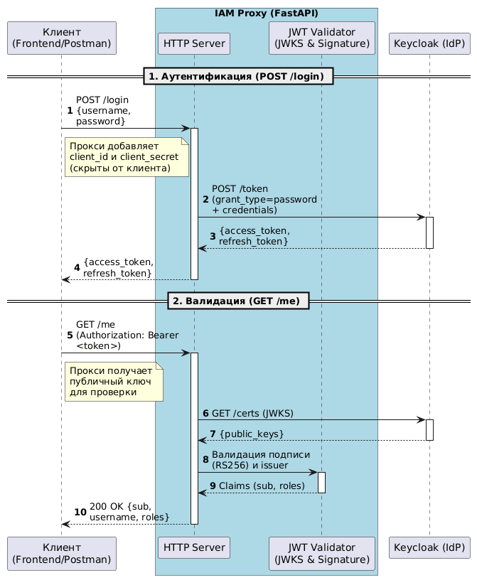

# IAM Proxy Service --- Keycloak Integration Demo

> Прототип IAM-прокси для демонстрации интеграции с Keycloak, валидации JWT и извлечения ролей (identity context).
> **Не является полноценной системой авторизации (RBAC enforcement).**

## Interactive API Documentation

-   **Static API Docs (GitHub Pages):**
    https://chr1swhite.github.io/iam-identity-proxy-demo/index.html
-   **Local Swagger UI:** `http://localhost:8000/docs` (available after
    starting the proxy)

## 1. Концепция

Проект демонстрирует паттерн безопасной интеграции микросервисов с
Identity Provider (Keycloak) через слой проксирования. Фронтенд или
клиентское приложение не обращается к Keycloak напрямую: прокси скрывает
`client_secret`, централизует логику аутентификации и валидации JWT, а
также извлекает роли пользователя для последующего контроля доступа
(RBAC).

Такой слой позволяет заменить IdP без изменения клиентского кода и не
выпускать Keycloak во внешний периметр.

## 2. Как это работает под капотом (Deep Dive)

Взаимодействие разделено на два ключевых этапа: получение токена
(аутентификация) и его проверка (авторизация).

### 2.1. Аутентификация --- `POST /login`

1.  Клиент отправляет `username` и `password` в открытом виде (по HTTPS)
    на наш прокси.
2.  Прокси **не проверяет пароль сам** и **не хранит хэши**. Он берет
    эти данные и добавляет к ним `client_id` и `client_secret` (которые
    знает только он).
3.  Прокси отправляет POST-запрос в Keycloak по эндпоинту `/token` с
    `grant_type=password`.
4.  **Keycloak берет на себя всю криптографию**: находит пользователя в
    своей БД, достает его соленый хэш пароля (например, PBKDF2 или
    Argon2), хэширует полученный от прокси пароль и сравнивает
    результаты.
5.  Если пароли совпали, Keycloak генерирует JWT (JSON Web Token) и
    подписывает его своим приватным ключом (RS256). Прокси возвращает
    этот токен клиенту.

**Граница доверия:** 
Прокси хранит секрет конфиденциального клиента (confidential client) и не передаёт его клиентскому приложению. Это снижает риск раскрытия секрета, но само по себе не защищает от компрометации пользовательских учётных данных или всех сценариев несанкционированного получения токена.

### 2.2. Авторизация и валидация --- `GET /me`

1.  Клиент передает полученный JWT в заголовке
    `Authorization: Bearer <token>`.
2.  Прокси идет в Keycloak по эндпоинту `/certs`, чтобы забрать
    **публичный ключ** (JWKS).
3.  Прокси проверяет **подпись токена** этим публичным ключом. Если
    токен подделан (изменен хотя бы один символ в payload), подпись не
    сойдется, и прокси вернет `401`.
4.  Прокси также проверяет поле `iss` (`issuer`), чтобы убедиться, что
    токен выпущен именно нашим Keycloak, а не сторонним сервером.
5.  Если проверки пройдены, прокси парсит payload и достает роли
    (`iam-user`) для дальнейшего контроля доступа (RBAC).

## 3.Схема взаимодействия (Workflow)

.

## 4. Реализованный функционал

-   Локальное развёртывание Keycloak в изолированном контейнере: Docker
    Compose и персистентный volume.
-   Эндпоинт `POST /login`: проброс `grant_type=password` в Keycloak с
    обогащением запроса `client_id` и `client_secret` на стороне прокси.
    Секрет не уходит клиенту.
-   Эндпоинт `GET /me`: валидация подписи JWT по JWKS Keycloak (RS256), проверка `iss`, извлечение `sub`, `preferred_username` и **извлечение ролей** (identity-контекст) для передачи бизнес-логике.
-   **Изоляция секретов:** все параметры подключения и `client_secret`
    читаются из переменных окружения.
-   Интерактивная документация Swagger UI с поддержкой авторизации по
    Bearer-токену.
-   Health-check: `GET /health`.

## 5. Quick Start

Для локального запуска потребуются Docker и Python 3.10+.

### Шаг 1. Клонировать репозиторий

``` bash
git clone https://github.com/chr1swhite/iam-identity-proxy-demo.git
cd iam-identity-proxy-demo
```

### Шаг 2. Настроить переменные окружения

Скопируйте шаблон и заполните `KEYCLOAK_CLIENT_SECRET`. Его можно взять
в Keycloak UI: **Clients → iam-proxy-client → Credentials**.

``` bash
cp .env.example .env
```

### Шаг 3. Поднять Keycloak

``` bash
docker compose up -d
```

Дождитесь запуска (около 30 секунд) и откройте Admin Console:
`http://localhost:8080`. Логин и пароль по умолчанию: `admin` / `admin`.

### Шаг 4. Импортировать преднастроенный Realm

В Keycloak UI выберите **Create Realm → Browse**, укажите файл
`realm-export.json` из корня проекта и нажмите **Create**.

Это создаст realm `iam-demo`, клиента `iam-proxy-client` и пользователя
`testuser`.

### Шаг 5. Запустить прокси

``` bash
pip install -r requirements.txt
uvicorn main:app --reload --port 8000
```

Сервис будет доступен по адресу `http://localhost:8000`.

## 6. Проверка работы через Swagger UI

Проект использует встроенную в FastAPI генерацию OpenAPI-документации.

-   **Static API Docs (GitHub Pages):**
    https://chr1swhite.github.io/iam-identity-proxy-demo/index.html
-   **Local Swagger UI:** `http://localhost:8000/docs`

Как проверить работу локально:

1.  Выполните `POST /login` через **Try it out → Execute**.
2.  Скопируйте `access_token` из ответа.
3.  Нажмите **Authorize** (иконка замка в правом верхнем углу).
4.  Вставьте токен без слова `Bearer` и нажмите **Authorize → Close**.
5.  Выполните `GET /me`. Эндпоинт вернет `username` и список `roles`,
    извлеченных из JWT.

## 7. API Specification

### 7.1. `POST /login`

**Пример запроса:**

``` bash
curl -X POST http://localhost:8000/login \
  -H "Content-Type: application/json" \
  -d '{"username":"testuser","password":"password123"}'
```

**Пример ответа `200 OK`:**

``` json
{
  "access_token": "eyJhbGciOiJSUzI1NiIs...",
  "refresh_token": "eyJhbGciOiJSUzI1NiIs...",
  "expires_in": 300,
  "token_type": "Bearer"
}
```

### 7.2. `GET /me`

**Пример запроса:**

``` bash
curl -X GET http://localhost:8000/me \
  -H "Authorization: Bearer <access_token>"
```

**Пример ответа `200 OK`:**

``` json
{
  "sub": "489a5af2-0726-44d2-a267-f1aa81eb20fb",
  "username": "testuser",
  "email": "testuser@example.com",
  "roles": [
    "default-roles-iam-demo",
    "iam-user",
    "offline_access",
    "uma_authorization"
  ],
  "issuer": "http://localhost:8080/realms/iam-demo",
  "expires_at": 1793148254
}
```

**Пример ответа `401 Unauthorized` для невалидного токена:**

``` json
{
  "detail": "Invalid token: Signature verification failed."
}
```

## 8. Осознанные упрощения и отличия от production

-   **`grant_type=password` (Direct Grant):** используется для
    наглядности в демо. В production рекомендуется Authorization Code +
    PKCE.
-   **Кэширование JWKS:** кэшируется без TTL (`lru_cache`). В production
    нужны TTL и инвалидация по `kid`.
-   **Проверка audience:** `verify_aud: False`, поскольку Keycloak
    кладёт в `aud` значение `account`. В production следует настроить
    Protocol Mapper, добавляющий `client_id` в `aud`, и включить строгую
    проверку audience.
-   **Хранение секретов:** секреты читаются из `.env`. В production
    следует использовать secret manager, Vault или Kubernetes Secrets.
-   **TLS:** в демо используется HTTP без TLS. В production нужна
    TLS-терминация на ingress/gateway.
-   **Конфигурация Keycloak**: start-dev и admin/admin используются только для локального запуска. В проде — start (production mode), HTTPS и сгенерированные пароли.
- **RBAC (enforcement)**: прокси извлекает роли, но не блокирует доступ к бизнес-операциям (нет проверки `if 'admin' not in roles: raise 403`). Это задача сервисов, стоящих за прокси.
- **Rate limiting**: эндпоинт `/login` не защищён от брутфорса. В проде — обязателен rate limiter на уровне API Gateway или Nginx.
- **Проверка aud**: отключена (`verify_aud: False`), так как Keycloak по умолчанию ставит `aud: account`. В проде — настройка Protocol Mapper и строгая проверка.

## 9. Тестирование

В проекте реализованы тесты (`pytest`), подтверждающие корректность обработки негативных сценариев (не требуется запущенный Keycloak):

```bash
pytest test_main.py -v

Проверяется:
-   Отказ при отсутствии токена (403).
-   Отказ при невалидном формате токена (Malformed token, 401).
-   Отказ при неправильном issuer (401).
-   Отказ при неизвестном kid (401).